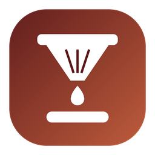

<p align="center"></p>
<h1 align="center">Pour</h1>
<p align="center">A video and audio downloader that lives in the Windows tray. Powered by yt-dlp and ffmpeg.</p>
<p align="center"><a href="../../releases/latest"><b>Download the latest release</b></a></p>

## Features
- **MP4 or MP3**, in Best / 2K / 1080p / 720p.
- **Copy a link anywhere** and click the notification to download it, or press **Ctrl+Alt+D**.
- Paste several links at once, or drag them from the browser onto the panel.
- **Queue** with 1 to 4 downloads at once, cancel / retry / open / show in folder.
- Whole playlists go into their own numbered folder.
- Embeds cover art and info, sets up yt-dlp + ffmpeg by itself on first run and keeps yt-dlp updated daily.
- Tray ring fills while downloading, flashes green when done.

## Install
1. Download `Pour-1.1.zip` from [Releases](../../releases/latest) and unzip it into its own folder.
2. Run `Pour.exe`. If SmartScreen warns, click **More info > Run anyway** (the exe is unsigned).
3. The first launch downloads yt-dlp and ffmpeg (about 150 MB, one time) into `%LOCALAPPDATA%\Pour\bin`.

Files save to `Downloads\Pour` by default (change it from the gear menu). DRM-protected services can't be downloaded.

## Build
```
cd src
dotnet build -c Release
```
On Linux it builds against Mono's .NET Framework 4.8 reference assemblies (`mono-devel`).

## Credits
[yt-dlp](https://github.com/yt-dlp/yt-dlp) and [FFmpeg](https://ffmpeg.org) do the heavy lifting; they are downloaded at runtime, not bundled.

## License
MIT
